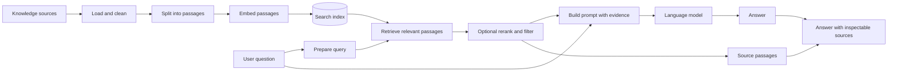

<div align="center">

# Retrieval-Augmented Generation
### A visual, practical guide to building systems that retrieve before they answer

[](GUİDE.md)
[](SOURCE.md)
[](CHANGELOG.md)

**Understand the pipeline. Explore the tools. Learn how to evaluate the results.**

</div>

---

<p align="center">
  <a href="https://unsplash.com/s/photos/data-visualization">
    
  </a>
</p>

<p align="center"><sub>Illustrative cover image from <a href="https://unsplash.com/s/photos/data-visualization">Unsplash data visualization photography</a>. It is not a screenshot or a representation of a running application.</sub></p>

> **What this repository is:** a documentation-first learning guide to Retrieval-Augmented Generation (RAG), with an illustrative Python example and a curated reading list.
>
> **What it is not:** a packaged application, hosted service, benchmark, or production-ready RAG system. The example has not been tested as a runnable project in this repository.

## Navigate the guide

- [Why RAG?](#why-rag)
- [How the pipeline works](#the-rag-pipeline)
- [Key design choices](#key-design-choices)
- [Illustrative implementation](#illustrative-python-walkthrough)
- [Evaluation](#evaluation-start-with-evidence)
- [Learning path](#a-guided-learning-path)
- [References and project files](#references-and-project-files)
- [Limitations and contribution guide](#scope-limitations-and-contributing)

<details>
<summary><strong>Start here if you have 5 minutes</strong></summary>

RAG gives a language model relevant material retrieved from an external collection at question time. A basic system loads and splits documents, indexes them, retrieves passages for a question, and asks a model to answer using those passages. RAG can make answers easier to ground and inspect, but it does not guarantee that retrieval is relevant or that the generated answer is correct.

Read the [pipeline overview](#the-rag-pipeline), then open the [learning path](#a-guided-learning-path) for a suggested sequence.

</details>

## Why RAG?

A language model may not know the contents of a private document collection, may not have current information, or may produce an answer that sounds convincing without being supported by evidence. RAG is a system pattern for bringing selected external material into the model's context when a question is asked.

The retrieval step can make the evidence used by a response more inspectable. It does **not** eliminate hallucinations, guarantee freshness, or make citations trustworthy by itself. Those properties depend on the sources, indexing and retrieval choices, answer-generation process, and evaluation.

| Need | What RAG can contribute | What still needs to be checked |
|---|---|---|
| Answer from a document collection | Retrieves passages related to the question | Did retrieval find the right passages? |
| Use information outside model training | Supplies external context at request time | Is the source current and authoritative? |
| Show supporting material | Returns source passages alongside an answer | Does each citation actually support the claim? |
| Adapt to a specialized topic | Connects a general model to selected domain material | Are coverage, access control, and evaluation adequate? |

## The RAG pipeline

The diagram below shows a common RAG workflow. Real systems may add query rewriting, reranking, hybrid search, access checks, caching, or multiple retrieval stages.



### 1. Ingest and prepare the data

Collect documents from the sources you are allowed to use. Extract text, preserve useful metadata, and handle malformed or duplicate content. If a document has pages, headings, owners, or publication dates, keep that information where it can help filtering and citations later.

### 2. Split documents into passages

Split text into pieces that fit the retrieval and generation workflow. Very small passages can lose context; very large passages can dilute relevance and consume more prompt space. There is no universally correct chunk size: compare options against representative questions and the structure of your documents.

### 3. Create and store embeddings

An embedding model maps text to vectors so that semantically related passages can be found. Store each vector with the corresponding text and metadata. The embedding model, normalization, distance function, and index configuration can all affect retrieval quality.

### 4. Retrieve evidence for a question

Embed or otherwise process the user's query, search the index, and select candidate passages. Consider metadata filters or keyword search when meaning alone is not enough—for example, exact names, dates, identifiers, or access restrictions.

### 5. Generate an answer from the retrieved context

Give the model the question and selected passages. Ask it to distinguish supported facts from missing information, and preserve links or identifiers needed to trace the answer. Prompt instructions help, but they are not a substitute for evaluation or access controls.

### 6. Evaluate and improve

Measure retrieval and answer quality separately. A fluent answer can still be based on irrelevant context, while a good retrieval result can still be summarized incorrectly.

## Key design choices

<details>
<summary><strong>Chunking: where should I start?</strong></summary>

Start with a simple baseline that respects document boundaries where possible. Keep metadata such as title, section, URL, and page number. Then compare chunk sizes and overlap using a set of real questions and known relevant passages. Inspect failure cases instead of assuming that a larger overlap or smaller chunk is always better.

</details>

<details>
<summary><strong>Vector search or keyword search?</strong></summary>

Vector search can retrieve conceptually similar passages even when wording differs. Keyword search can be better for exact terms, codes, names, and numeric identifiers. Hybrid approaches combine both, but add complexity and need their own evaluation. Choose based on the language and structure of the corpus and the kinds of questions users ask.

</details>

<details>
<summary><strong>Do I need a reranker?</strong></summary>

A reranker can reorder candidate passages using a more detailed relevance comparison. It may improve precision when the first retrieval stage returns many plausible passages, but it adds latency, cost, and another component to maintain. Measure its effect on representative questions before adopting it.

</details>

<details>
<summary><strong>Does RAG prevent hallucinations?</strong></summary>

No. RAG can provide useful evidence in the prompt, but a model can ignore, misread, or overstate that evidence. Retrieval can also miss the needed material. Evaluate groundedness and citation support, and allow the system to say when the available sources do not answer the question.

</details>

## Illustrative Python walkthrough

This shortened example is included to make the stages concrete. It is **not** a tested script or a runnable application supplied by this repository. Package APIs and model names change; check the official documentation linked in [`SOURCE.md`](SOURCE.md) before using a similar implementation.

```python
# Illustrative outline only — not tested as a repository application.

# 1. Load documents from a permitted source.
documents = load_documents("path/to/documents")

# 2. Split the documents while retaining source metadata.
passages = split_into_passages(
    documents,
    chunk_size=1000,
    chunk_overlap=150,
)

# 3. Embed passages and save them in a searchable index.
index = build_vector_index(passages, embedding_model="your-embedding-model")

# 4. Retrieve evidence for a question.
question = "What does the policy say about eligibility?"
evidence = index.search(question, top_k=4)

# 5. Ask a model to answer using the retrieved evidence.
answer = generate_answer(
    question=question,
    context=evidence,
    instruction="Answer from the supplied evidence; say when it is insufficient.",
)

# 6. Return the answer with source references for inspection.
print(answer.text)
print(answer.sources)
```

The function names above are explanatory placeholders, not imports from a particular library. The repository currently provides no dependency lockfile, sample corpus, executable entry point, automated evaluation set, or deployment configuration.

### What a runnable companion project would need

If this guide is later expanded into an application, document and provide at least:

- A tested source tree and supported runtime version.
- A dependency file with compatible versions.
- A small, licensed sample dataset or clear instructions for supplying one.
- Configuration instructions that keep API keys out of source control.
- A command to build the index and a command to ask a question.
- Error handling for missing files, empty retrieval, and provider failures.
- An evaluation set and a repeatable way to measure changes.

Until those pieces exist, readers should treat the code above as conceptual pseudocode.

## Evaluation: start with evidence

Build a small evaluation set from questions people actually need answered. For each question, record the expected supporting source passages and the key facts a correct answer should contain.

| Evaluation area | Example question | What to inspect |
|---|---|---|
| Retrieval relevance | Did the search return the relevant policy section? | Relevant passages in the top results; misses and irrelevant matches |
| Context coverage | Did the retrieved passages contain enough evidence? | Whether all required facts are present before generation |
| Answer correctness | Did the response reflect the source accurately? | Unsupported, omitted, or contradicted claims |
| Citation support | Do the cited passages support the nearby statements? | Citation-to-claim alignment and source identifiers |
| Abstention | What happens when no source answers the question? | Whether the system communicates uncertainty instead of guessing |
| Robustness | Does paraphrasing change the result materially? | Performance across alternate wording and ambiguous queries |

Keep retrieval metrics separate from answer-quality metrics. Review representative failures manually; aggregate scores can hide cases where a system sounds confident while using the wrong evidence.

## A guided learning path

<details>
<summary><strong>Path A — I am new to RAG</strong></summary>

1. Read the [RAG overview](https://python.langchain.com/docs/tutorials/rag/) in the reference list.
2. Learn the roles of document loading, chunking, embeddings, indexes, retrieval, and generation.
3. Draw the pipeline for a small document collection.
4. Use the [main guide](GUİDE.md) to review practical design choices.
5. Finish by writing down one failure mode for each pipeline stage.

</details>

<details>
<summary><strong>Path B — I have built a basic RAG demo</strong></summary>

1. Read the [original RAG paper](https://arxiv.org/abs/2005.11401) and compare its framing with modern retrieval systems.
2. Create a fixed question set with expected evidence.
3. Compare chunking and retrieval settings one change at a time.
4. Add source metadata and verify that citations support claims.
5. Review the [evaluation resources](SOURCE.md) and record limitations alongside results.

</details>

<details>
<summary><strong>Path C — I am choosing tools</strong></summary>

Start from your requirements: corpus size, update frequency, privacy, latency, filters, deployment environment, and budget. The [reference list](SOURCE.md) includes several frameworks and vector search tools; it is a reading list, not an endorsement or a claim that this repository integrates them.

</details>

## Knowledge check

<details>
<summary><strong>Question 1: If the answer is wrong, should I immediately change the language model?</strong></summary>

Not necessarily. First inspect the retrieved passages. The failure may come from missing or stale data, extraction, chunking, query handling, retrieval, prompt construction, or generation. Diagnose the stage before changing components.

</details>

<details>
<summary><strong>Question 2: If an answer includes a citation, is it grounded?</strong></summary>

Not automatically. Check whether the cited passage supports the specific claim and whether the passage is itself trustworthy and current.

</details>

<details>
<summary><strong>Question 3: What should happen when the evidence is insufficient?</strong></summary>

The system should communicate that limitation, ask a useful follow-up, or point to the closest available sources. It should not fill the gap with an unsupported guess.

</details>

## References and project files

The repository's [`SOURCE.md`](SOURCE.md) groups documentation, research, video tutorials, example repositories, and tools. It records a verification date of **September 2, 2026**; links and product details may have changed since that review. Check upstream sources directly before relying on them.

| File | Purpose |
|---|---|
| [`GUİDE.md`](GUİDE.md) | Main long-form guide |
| [`SOURCE.md`](SOURCE.md) | Curated sources and references |
| [`CHANGELOG.md`](CHANGELOG.md) | Change history |
| [`LICENSE (MIT License).md`](LICENSE%20%28MIT%20License%29.md) | License file currently present in the repository |

> **Portability note:** the guide filename contains the Turkish dotted capital `İ` (`GUİDE.md`). A conventional `GUIDE.md` filename would be easier to use across platforms and tools. The license filename is also nonstandard; a root-level file named `LICENSE` is more readily recognized by repository tooling.

## Scope, limitations, and contributing

This repository is educational material. It does not claim that a particular RAG stack is best, that its example has been tested, or that RAG guarantees factuality. The reference list reflects the project's stated review date and should be maintained as links and software evolve.

Contributions that improve clarity, correct technical details, or add useful primary references are welcome. Please include the source for factual claims and note what you checked. For resource updates, include the date the link and description were reviewed.

## License

See [`LICENSE (MIT License).md`](LICENSE%20%28MIT%20License%29.md) for the license included with the project.

---

<div align="center">

**Learn the retrieval step. Inspect the evidence. Evaluate the answer.**

</div>
